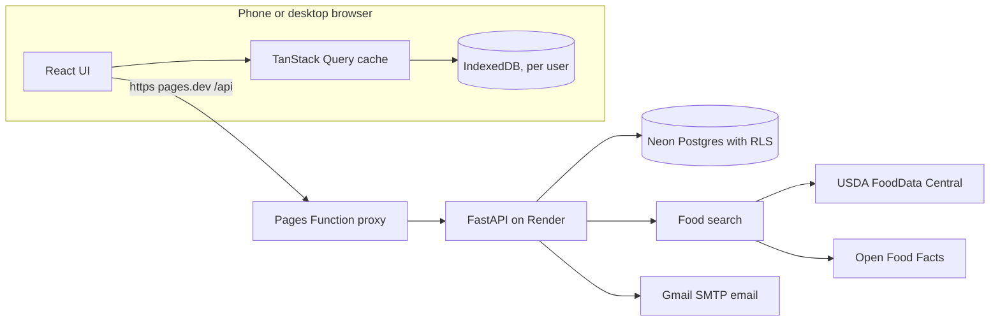
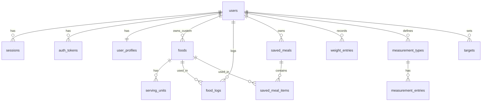

# TRIM: Product and Technical Specification

*Track, Record, Inspect, Measure*

Version 0.3 (draft for approval), 17 Oct 2026. Owner: Murali.

Changes in 0.11: suggestions now respect food pairing (generic pairing scores computed from public US dietary survey data, plus each user's own eating history and "don't pair these" feedback); Shuffle and item locking; offline logging and the travel timezone prompt moved to a later update.

Changes in 0.10: My staples (up to 20 regular foods) and "What should I eat?" suggestions that combine staples to fit the calories and macros left today, using a deterministic optimizer (no AI).

Changes in 0.9: gamification: logging streak with freezes and repair, weekly weigh-in streak, weekly goals, milestone badges, optional streak reminders, and an off switch. Streaks reward logging, never eating less.

Changes in 0.8: product renamed from Tallyfork to TRIM (Track, Record, Inspect, Measure); the full form appears under the title on every page.

Changes in 0.7: saved meals (custom meals) moved to MVP: save a group of foods once and log it in one tap, with portion scaling and per-item edits.

Changes in 0.6: added "What fits my macros", diet phases, goal-date projection, water and fiber tracking, weekly check-in summaries, and on-demand download of all data as Excel (.xlsx), CSV or JSON.

Changes in 0.5: all AI removed for now. No meal photo logging, no vision or LLM providers, no Hugging Face, no RAG, no agents. Roadmap is now 5 milestones.

Changes in 0.4.2: clearer sex field wording at sign-up (hormonal makeup), following the Forbes Health TDEE calculator page.

Changes in 0.4.1: BMI-based plan suggestion at sign-up (lose at TDEE minus 600 to 700 kcal when BMI is 25 or more; protein 0.7 g/lb and fat 25% of calories when BMI is 30 or more), with a calorie floor.

Changes in 0.4: TDEE calculator (Mifflin-St Jeor), body stats collected at sign-up, default targets from fixed macro rules (protein 0.8 g/lb, fat 0.3 g/lb, carbs fill the rest).

Changes in 0.3.1: dashboard and chart design rules, Progress dashboard, glance test; donut and dual-axis charts removed.

Changes from 0.2: food is logged at a specific time instead of in meal slots; the Today screen becomes a time-ordered timeline (design on page 4); macro colors updated.

Changes from 0.1: now a responsive website for phone and desktop; multi-user sign up and login with per-user data isolation; barcode scanning and the label-photo fallback removed; the cross-site cookie bug fixed by serving the app and API from one origin.

Name check (17 Oct 2026): "Trim" is already used by a weight-loss and calorie-tracking iPhone app ("Trim - Weight loss programme" by XO Medical, Health & Fitness category) **[V]**, by a nutrition app called Trimly **[V]**, and by a well-known money-saving finance app owned by OneMain **[V]**. Fine for a personal and small private site; before any public launch, get a trademark check and consider a distinct full brand such as "TRIM Tracker" or a unique domain. Not a legal opinion.

Legend: **[V]** verified against a current source (Sources, page 5). **[?]** uncertain, re-check during the named milestone.

---

## Page 1: Product and scope

### Problem
Logging food, weight and body measurements is slow in most apps, good ones are subscription priced, and targets are often changed by an algorithm. I want a fast, private tracker that works equally well on my phone and my laptop, where each person who signs up sees only their own data and sets their own targets.

### Goals
1. Anyone can sign up, log in, and see only their own account.
2. Log a known food in under 5 s, a weight or measurement in under 3 s.
3. Show calories and macros remaining at a glance, on any screen size.
4. Honest trend charts for weight, measurements and intake.
5. Users own their data: full export and account deletion. Run at about $1 per month.
6. Give every new user sensible starting targets from a TDEE calculator, using fixed macro rules.

### Non-goals (v1)
No adaptive TDEE: the app never estimates expenditure from logged intake or weight trends, and never changes targets on its own. The TDEE calculator is a one-time formula the user runs on demand; targets change only when the user applies a new result or edits them. No coaching; trend math is display only. **No AI in this version:** no photo logging, no LLM or vision model calls, no Hugging Face models, no RAG, no agents. The app has no AI provider dependency; photo logging may return in a later version. No barcode scanning. No social feed, no sharing between users, no workout tracking. No native app store build. No copying of MacroFactor or Cal AI branding, copy, UI assets or databases.

### User stories
- As a visitor, I sign up with email and password, enter my age, sex, weight, height and activity level, see my TDEE and starting macros, and start logging.
- As a user, I open the TDEE calculator after losing 5 kg, recalculate, and choose whether to apply the new targets.
- As a user, I log breakfast on my phone and review weekly charts on my laptop that evening.
- I add what I ate at 4:00 PM, even if I log it at 7:00 PM, and it appears in the 4 PM block of my timeline.
- I add a metric "Wrist" in cm, paired left/right, and chart it next to forearms.
- I export everything as JSON and CSV, or delete my account and all data.
- Two users on the same site can never see each other's entries.

### Success metrics
| Metric | Target | How measured |
|---|---|---|
| Food logged from search or recents | p75 under 5 s | in-app timing log |
| Weight or measurement entry | p75 under 3 s | in-app timing log |
| Data isolation | 0 cross-user reads or writes | automated isolation suite on every endpoint |
| Responsive layout | usable 360 px to 1920 px, no horizontal scroll | visual regression at 375, 768, 1280, 1920 |
| Performance | Lighthouse mobile performance 90 or higher | CI Lighthouse run |
| Charts, 1 year of data | render under 300 ms on a mid-range phone | `performance.now()` |
| Dashboard is intuitive | at least 13 of 15 glance-test answers correct within 5 s | glance test, page 4 |

### Feature table
| Feature | Priority | Rationale |
|---|---|---|
| Sign up, login, logout, email verify, password reset | MVP | Required for multi-user |
| Account page: profile, units, change password, delete account | MVP | User owns account |
| Body stats at sign-up + TDEE calculator + macro rules | MVP | Every user starts with targets, no guesswork |
| What fits my macros | MVP | Answers "what should I eat with what's left?" without AI |
| Water and fiber tracking | MVP | Common daily targets, cheap to add |
| Goal-date projection (display only) | MVP | Makes the weight trend concrete |
| Diet phases (cut, maintain, bulk) | MVP | Compare periods on every chart |
| Weekly check-in summary | MVP | One plain-language recap per week |
| Download all data (Excel, CSV, JSON) anytime | MVP | Users own their data |
| Responsive layout (phone, tablet, desktop) | MVP | Core requirement |
| Weight log + EWMA trend chart | MVP | High value, proves charts |
| Food log, targets, Today dashboard | MVP | Core daily use |
| Time-based logging and Today timeline | MVP | Log exactly when I ate, see the day in order |
| Recents, frequents, favourites, quick-add, copy a time block, custom foods | MVP | Speed |
| Saved meals (custom meals) | MVP | Log a repeated meal in one tap instead of adding each food |
| My staples (up to 20) + "What should I eat?" combination suggestions | MVP | Turns what's left today into a concrete plate from foods the user actually eats |
| Streaks, weekly goals and badges (can be turned off) | MVP | Makes daily logging a habit, Duolingo-style |
| Text food search (USDA FDC, Open Food Facts) | MVP | Main way to find foods now |
| Custom measurements + charts | MVP | Differentiator |
| Import from JSON export | MVP | Restore or move an account |
| Recipe builder (cooked dish as one food, per gram), overlay and combined charts | v1.1 | Value grows with history |
| Sign in with Google | v1.1 | Convenience |
| Offline logging (with device-created timestamps so offline entries keep streaks) | Later update | Logging without a connection |
| Travel timezone prompt ("Switch your days to this timezone?") | Later update | Correct days while traveling |
| Progress photos | Later | Nice to have |

### UX principles
1. **Speed above all.** Recents and favourites appear before typing; last serving remembered per food.
2. **Same app, adapted layout.** Phone: one-handed, bottom tab bar. Desktop: sidebar, multi-column, keyboard shortcuts.
3. **Minimal taps.** New entries default to the current time (rounded down to 5 minutes) in the user's timezone, or to the time of the block whose "+" was tapped; the time is one tap to change.
4. **Accessible.** 44 px touch targets on touch screens, WCAG 2.2 AA contrast, every chart has a text summary and a table view.
5. **Dark first.** The app opens in its dark theme. Light and "Match device" (`prefers-color-scheme`) are one choice away in Account, Appearance. Both themes are CSS variables and meet WCAG 2.2 AA.

### Name and branding
- **Product name:** TRIM. **Full form:** Track, Record, Inspect, Measure.
- **Title block, shown on every page:** "TRIM" as the title with "Track, Record, Inspect, Measure" directly under it in smaller, lighter text.
  - Landing, sign-up and login pages: title 40 px bold, full form 16 px, centered above the form.
  - Desktop app (1024 px and up): top of the left sidebar, title 24 px, full form 12 px.
  - Phone and tablet app: top-left of the header, title 20 px, full form 11 px on one line; it never wraps or truncates down to 360 px wide (it fits in about 200 px).
  - The full form uses the secondary text color in both light and dark mode, still meeting WCAG AA contrast.
- **Browser and install names:** HTML `<title>` is "TRIM: Track, Record, Inspect, Measure" on the landing page and "Today, TRIM" style titles inside the app. Web manifest `name` "TRIM: Track, Record, Inspect, Measure", `short_name` "TRIM"; `apple-mobile-web-app-title` "TRIM", so the home-screen label reads TRIM.
- **Emails** (verification, reset, weekly check-in) use the same title block in the header.
- **Accessibility:** the title block is one `<header>` with an `<h1>` "TRIM" and a paragraph for the full form, so screen readers announce both once.

### Visual design: dark-first data
Chosen 20 Oct 2026 with the UI/UX Pro Max skill (`.claude/skills/ui-ux-pro-max`). The full token list and rules are in `design-system/MASTER.md`; this is the summary.
- **Feel:** a precise tracking tool. Dark surfaces, hairline borders instead of heavy shadows, compact spacing, numbers that line up.
- **Type:** Fira Sans for text and Fira Code for every number (amounts, calories, macros, weights, times), both SIL Open Font License 1.1, self-hosted from `@fontsource`. Numbers use tabular figures so columns align. Small uppercase labels with wide letter spacing name each figure ("KCAL", "LEFT").
- **Color:** near-black background (#0B0B0C) with slightly lighter surfaces; the accent is Okabe-Ito sky blue. Nutrient colors stay Okabe-Ito everywhere (calories sky blue, protein vermillion, fat orange, carbs bluish green). Where a nutrient color is used for text, each theme has a text-safe shade that meets 4.5:1; bars and chart lines keep the exact Okabe-Ito colors.
- **Shape:** 8 px corners on cards and controls, 12 px on sheets; 1 px borders; shadows only on floating layers (sheets, toasts, the selection bar).
- **Density:** the Today strip leads with calories on one line and protein, fat and carbs beneath; entries are compact rows. Touch targets stay at least 44 px on touch screens.

---

## Page 2: Architecture and tech stack

### Website approach
| Option | Pros | Cons |
|---|---|---|
| React SPA (Vite) + FastAPI | Simple static frontend, Python backend fits my skills, same backend as v0.1 | Two codebases |
| Next.js full stack | One codebase, SSR | Backend logic in TypeScript; Vercel Hobby is non-commercial **[?]** |
| Server-rendered (Django, HTMX) | Built-in auth | Weaker for interactive charts |

**Decision: React 19 + TypeScript + Vite + Tailwind CSS + TanStack Query on the frontend, FastAPI (Python 3.12) + SQLAlchemy 2 + Alembic + Postgres on the backend.** No SEO need behind a login, so SSR adds little. The site is also installable as a PWA (manifest, icons, `viewport-fit=cover`) so it can sit on an iPhone home screen, but it is first a normal website.

### One origin (fixes the v0.1 cookie bug)
Safari blocks cookies sent to a different site. The app is served at `https://<project>.pages.dev` from Cloudflare Pages, and a **Pages Function proxies `/api/*` to the API on Render**, so the browser only ever talks to one origin and the session cookie is first-party. No custom domain is needed (owner decision, 22 Oct 2026: run at $0); one can be added later without code changes.

### Responsive layout
| Breakpoint | Navigation | Today page | Charts |
|---|---|---|---|
| Under 640 px (phone) | Bottom tab bar: Today, Log, Body, Charts, Account; floating "+" | Single column: target strip, timeline | Full width, tap tooltips, pinch and drag zoom |
| 640 to 1023 px (tablet) | Bottom tab bar | Two columns: target strip and summary, timeline | Two per row |
| 1024 px and up (desktop) | Left sidebar | Three columns: target summary, timeline, mini weight and calorie charts | Hover tooltips, wheel zoom, drag to select range |

Rules: mobile-first CSS; `@media (pointer: coarse)` raises targets to 44 px; number inputs use `inputmode="decimal"` and 16 px text so iOS does not zoom on focus; tables become stacked cards under 640 px; charts redraw on `ResizeObserver`. Desktop shortcuts: `/` focuses food search, `w` opens weight entry, `Esc` closes dialogs. Modals are bottom sheets on phone and centered dialogs on desktop.

### Accounts and authentication
| Option | Cost | Control | Effort |
|---|---|---|---|
| Own auth in FastAPI | Free | Full, data in my Postgres | Most security work |
| Supabase Auth | Free tier, but projects pause after 1 week idle **[V]** | Medium | Low |
| Hosted (Clerk, Auth0) | Free tiers with limits **[?]** | Vendor holds identities | Lowest |

**Decision: own auth in FastAPI**, kept small and tested.
- **Sign up:** email, password (minimum 10 characters, checked against breached passwords via the Pwned Passwords range API: k-anonymity on the first 5 SHA-1 hex characters, no API key, no rate limit, `Add-Padding: true` sent **[V]**), display name, timezone (auto-detected), units. Then the body-stats step (see Sign-up flow, page 4). Cloudflare Turnstile on sign-up and reset forms: free plan, unlimited verifications, 20 widgets, tokens single use and valid 5 minutes, checked server-side at `/turnstile/v0/siteverify` **[V]**.
- **Passwords:** Argon2id via `argon2-cffi` with the OWASP minimum m=19456 KiB (19 MiB), t=2, p=1 **[V]**; never logged or returned.
- **Sessions:** random 256-bit token in an HttpOnly, Secure, SameSite=Lax cookie; only its SHA-256 hash is stored. 30-day sliding expiry with "Keep me signed in", otherwise a browser-session cookie that the server also ends after 24 hours without activity. In production the cookies use the `__Host-` prefix. All sessions revoked on password change.
- **CSRF:** SameSite=Lax plus a required `X-CSRF-Token` header (double-submit) on all writes.
- **Email:** verification and reset links (single-use, 1-hour expiry, hashed tokens) sent over SMTP from a Gmail account with an app password: free, about 500 recipients a day, no domain needed **[?]**. Resend (free plan 3,000 emails per month, 100 per day, needs a verified domain **[V]**) stays supported for when a domain is added. Unverified users can log for 7 days, then must verify.
- **Login protection:** 5 failed attempts per account and IP per 15 minutes, then a 15-minute lock; generic error messages so emails cannot be probed. The account and the IP are counted separately (either one reaching 5 locks), so one account guessed from many IPs and many accounts tried from one IP are both stopped. Unknown emails lock the same way. Counters live under keyed hashes, never plain emails or IPs. Sign-ups are limited to 10 per IP per hour.
- **v1.1:** Sign in with Google (OAuth, linked by verified email).

### Per-user data isolation
Every user-owned table has `user_id NOT NULL`. Two layers:
1. **Application:** every repository function takes `user_id` from the session, never from the request body or URL.
2. **Database:** Postgres row-level security. Each request runs `SET LOCAL app.user_id = '<uuid>'`, and each table has a policy `USING (user_id = current_setting('app.user_id')::uuid)`. The app's database role has no `BYPASSRLS`. Requests for another user's IDs return 404.

### Backend and local cache

The server is the source of truth. TanStack Query gives instant screens and optimistic writes. On trusted devices ("Keep me signed in"), recent data is cached in IndexedDB under a database named per user ID; logout and account switch delete it, so shared computers keep nothing. Full offline logging (outbox plus last-write-wins sync, as in v0.1) is deferred to a later update, together with the travel timezone prompt.

---

## Page 3: Food data and data model

### Food search waterfall (text)
1. **Personal:** the user's custom foods, favourites and previously logged foods.
2. **Cache:** shared `foods` rows from earlier lookups (refresh after 30 days). FoodData Central is asked when tiers 1 and 2 return fewer than 10 results; each external source is asked at most once per query in 30 days (a hash of the normalized query is kept, never the text). The API writes the cache only through the `cache_food()` database function.
3. **USDA FoodData Central:** CC0 public domain; data.gov key, default 1,000 requests per hour; the key must stay private **[V]**. Search Foundation, SR Legacy and Branded.
4. **Open Food Facts:** ODbL licence; custom User-Agent required **[V]**; search is limited to 10 requests a minute per IP (product reads 15) and must not be used for search-as-you-type **[V, OFF API docs, checked 20 Oct 2026]**. Every user's search leaves from our IP, so the API keeps one shared budget of 8 OFF searches a minute and queries OFF only when tiers 1 to 3 return fewer than 5 results. Attribution shown on food detail. Because OFF-derived rows are now served to many users, the shared cache counts as a derived database under ODbL share-alike; keep OFF rows flagged and offer them as an ODbL dump if ever published **[?, legal check before public launch]**.
5. **Manual entry**, saved as a private custom food.

Normalization: store per 100 g (per 100 ml with density, default 1.0 g/ml); serving units as rows; per100 = per_serving / serving_g x 100. Flag foods where kcal differs from 4P + 4C + 9F by more than 15%. Users can override any shared food; the override is private to them.

### Schema

| Table | Key columns |
|---|---|
| users | id (UUIDv7), email (unique, lowercased), email_verified_at, password_hash, created_at, last_login_at, status (active, locked, deleted), deleted_at |
| user_profiles | user_id, display_name, timezone, unit_system (metric, imperial), sex (male, female; used only by the formula), age_years and age_recorded_on (current age = age_years + whole years since), height_cm, activity_level (sedentary, light, moderate, heavy, athlete), goal_weight_kg, theme |
| sessions | id, user_id, token_hash, created_at, expires_at, last_seen_at, user_agent, ip_hash |
| auth_tokens | id, user_id, kind (verify, reset), token_hash, expires_at, used_at |
| foods | id, owner_id (null = shared cache), source (custom, fdc, off), source_ref, name, brand, kcal_100, protein_100, carbs_100, fat_100, fiber_100, sugar_100, sodium_mg_100 (null = unknown, not zero), density_g_ml. RLS: everyone reads shared rows and their own; users insert, update and delete only their own, so they can never edit the cache or publish a private food to it; the cache is written by the owner role. One cached row per source and source_ref |
| serving_units | id, food_id, label, grams, is_default (at most one per food). RLS follows the food: visible when the food is, writable when the food is the user's own |
| food_logs | id, user_id, food_id (null for quick add, or after the custom food is deleted), saved_meal_id (null unless logged from a saved meal), log_group_id (one id per add action, so a whole meal can be moved or undone together), eaten_at (timestamptz, required), logged_on (local date derived from eaten_at and the user's timezone, indexed), name and brand snapshot, grams, quantity and unit label (for "4 egg", "1 bottle"; null for quick add), nutrient snapshot (kcal, protein, carbs, fat, fiber, sugar, sodium_mg), source (search, recent, quick_add, meal, suggestion) |
| food_favourites | id, user_id, food_id (unique per user and food); recents and frequents are read from food_logs, and the last serving is the latest entry's amount |
| saved_meals | id, user_id, name (unique per user), note, is_favourite, use_count, last_used_at, archived_at |
| saved_meal_items | id, user_id, saved_meal_id, food_id, grams, quantity, unit_label, sort_order |
| weight_entries | id, user_id, measured_at, kg, note |
| measurement_types | id, user_id, name, unit (cm, in, %, kg, lb, text), precision, side, pair_id, is_preset, is_active, sort_order, archived_at; values are stored in cm, kg or %, and the unit only chooses the display (in shows cm, lb shows kg). Presets copied to each account, switched off until picked: Waist, Hips, Chest, Neck, Upper arm (left and right), Thigh (left and right), Body fat (%) |
| measurement_entries | id, user_id, type_id, value, value_text, measured_at, note |
| targets | id, user_id, effective_from, kcal, protein_g, carbs_g, fat_g, fiber_g, water_ml (null = not tracked), source (calculator, custom), calc_inputs JSON (age, sex, weight_kg, height_cm, activity_level, bmi, plan: maintain or lose, deficit_kcal, rule_set: standard or high_bmi, floor_applied), bmr, tdee, tolerance_pct (default 5) |
| annotations | id, user_id, on_date, label, scope |
| diet_phases | id, user_id, kind (cut, maintain, bulk, custom), label, start_date, end_date (null = ongoing), note; no two phases of a user may overlap |
| water_logs | id, user_id, logged_at, ml |
| weekly_checkins | id, user_id, week_start (local Monday), stats JSON, created_at, read_at, emailed_at |
| staples | id, user_id, food_id or saved_meal_id (exactly one), food_group (one of the 23 pairing groups), unit_label, unit_grams, step_units, min_units, max_units, is_available, sort_order; at most 20 per user (enforced in a trigger) |
| pairing_scores | context (breakfast, lunch, dinner, snack), group_a, group_b, lift, score, n_occasions, data_version; shared reference data, not per user |
| pair_preferences | id, user_id, staple_a_id, staple_b_id, kind (never), created_at |
| user_streaks | user_id, current_days, longest_days, last_counted_date, freezes_held (0 to 2), weigh_in_current_weeks, weigh_in_longest_weeks, updated_at |
| streak_events | id, user_id, on_date, kind (counted, freeze_earned, freeze_used, repaired, broken) |
| weekly_goals | id, user_id, week_start, goal_code, target, progress, completed_at |
| achievements | id, user_id, code, earned_at (unique per user and code) |
| push_subscriptions | id, user_id, endpoint, keys JSON, created_at, last_success_at |
| exports | id, user_id, format, date_from, date_to, datasets, row_count, created_at (audit only; files are not stored) |
| user_settings, audit_log | user settings JSON (track_water, track_fiber, water_unit ml or fl oz, checkin_email on or off, gamification on or off, streak_reminder off or a local time such as 20:00); audit_log: user_id, event (login, password_change, export, delete), at, ip_hash |

All user tables carry `user_id`, `created_at`, `updated_at`, `deleted_at` and an RLS policy. Presets for measurements are copied into each new user's `measurement_types` at sign-up, so renaming or archiving never affects anyone else. **Why type/entry for measurements:** new metrics need no migration, and history survives renames because entries point to the type id.

**What is stored per user:** account (email, password hash, verification state), profile (name, timezone, units, optional height and goal weight), settings, targets with history, every food log, custom food, saved meal, weight and measurement entry, water entry, diet phases, weekly check-ins, annotations, and a security audit log. Nothing else; no analytics profiles.

### Algorithms (display only, unchanged from 0.1)
**EWMA trend.** a = 0.1 per day (0.25 for measurements). Gap of d days: a_eff = 1 - (1 - a)^d; T = T_prev + a_eff x (x - T_prev). Example: 80.00 then 79.50 next day gives 79.95; 3 days later 79.20 gives a_eff = 0.271 and T = 79.75. Earliest reading of the day counts. Outlier when |x - T_prev| > max(2.0 kg, 3% of T_prev): shown hollow, excluded, and the next gap d runs from the last counted day. Trend appears after 5 counted readings (first of their day, not outliers) whose first and last days span at least 7 calendar days, counting both ends. Test vectors: `shared/trend_vectors.json`.

**Weekly rate:** least-squares slope of the last 14 days of trend values x 7 (-0.064 kg/day gives -0.45 kg/week). The 14 calendar days end on the latest counted reading; at least 2 days of trend are needed. **Indexed change:** 100 x (v / v_base - 1); waist 90.0 to 87.3 cm gives -3.0%. **Rolling 7-day kcal:** mean of logged days, at least 4 needed. **Units:** stored as kg and cm; 1 lb = 0.45359237 kg, 1 in = 2.54 cm. **Adherence:** |intake - target| / target at most 0.05. **Logged nutrients:** grams x per100 / 100 (rice 150 g at 130 kcal/100 g gives 195 kcal). **Days** are computed in the user's own timezone, so a user in Tokyo and one in New Jersey each get correct "today" boundaries.

### Planning and review features (all display only, no targets change)
**What fits my macros.** Available on the Log food screen as a "Fits my macros" sort when today has a target. Candidates: the user's favourites, saved meals (scored on their totals), custom foods and foods logged in the last 60 days, each at its default serving (fast, no remote search). Remaining today R_m = target_m - eaten_m for kcal, protein, carbs and fat. Weights w: kcal 0.25, protein 0.35, carbs 0.20, fat 0.20.
- Coverage = sum of w_m x min(n_m / R_m, 1); overflow = sum of w_m x max(n_m / R_m - 1, 0); fit score = coverage - overflow.
- A macro already met or exceeded (R_m at or below 0) counts any amount of it as overflow: w_m x n_m / target_m.
- Labels: score 0.5 or more "Great fit", 0.25 to 0.5 "Partial fit", below 0.25 hidden from this sort. Each row shows which macros it fills as small colored bars and "fits up to 180 g" (the largest grams that keep kcal within R_kcal).

Example, with 300 kcal, 40 P, 25 C, 8 F left: chicken breast 120 g (198 kcal, 37.2 P, 0 C, 4.3 F) scores 0.60, Great fit; Greek yogurt 0% 200 g scores 0.35; peanut butter 32 g scores 0.28 (fat overflows); cooked rice 150 g scores 0.27 (carbs overflow).

**Goal-date projection.** weeks = (goal_kg - trend_kg) / weekly_rate. Shown only when a goal weight is set, the trend is visible, the rate is at least 0.1 kg a week and moving toward the goal, and the result is within 104 weeks. Otherwise: "No projection: your trend is flat or moving away from your goal." Example: trend 79.8 kg, goal 75.0, rate -0.45 kg a week gives 10.7 weeks, so "around 31 Dec 2026 if your current rate continues" (from 17 Oct 2026). Drawn as a dotted line from today's trend to the goal, labeled "projection".

**Water.** Quick buttons +250 ml, +500 ml and custom (or +8, +16 fl oz; 1 fl oz = 29.5735 ml). Water target is set by the user; no default. Tracking is off until the user turns it on.

**Fiber.** Default target 14 g per 1,000 kcal of the calorie target, the Adequate Intake from the Institute of Medicine's Dietary Reference Intakes (2002), which the Dietary Guidelines for Americans use **[V]**; 2,759 kcal gives 39 g. Editable. Fiber is summed from logged foods where the source has fiber data; foods missing fiber are counted and the day shows "fiber unknown for 2 foods".

**Diet phases.** Users create date ranges of kind cut, maintain, bulk or a custom label. Creating a phase never changes targets; the dialog offers a separate, explicit "Also update targets" button. Each phase gets a summary: days, average kcal vs target, days on target, weight trend change and weekly rate, and change in each active measurement.
- Both ends are inclusive and no two of a user's phases may share a day; an overlap is rejected with a message naming the phase it clashes with. A phase with no end date is ongoing, so the next one needs it ended first; "New phase" offers to end it the day before the new one starts. A phase can start up to a year ahead.
- The summary runs from the start to the end date, or to today while the phase is ongoing (an upcoming phase has none). Average kcal is over logged days, against the average target in effect on those days. On target means within 5% of that day's target, as on the Calories card.
- Weight trend change is the trend (alpha 0.1, computed over every weigh-in) on the phase's first weigh-in subtracted from the trend on its last. The weekly rate is that change over the days between them, times 7, shown once they are 7 or more days apart.
- Each switched-on measurement with 2 or more readings in the phase shows the change from its first to its latest reading.
- The "first completed diet phase" badge is earned the day after a phase's end date.

**My staples and "What should I eat?"** A user keeps up to 20 staples: foods or saved meals they eat regularly. Each staple has a unit (its default serving, such as "100 g", "1 egg" or "1 cup") and allowed amounts per suggestion: countable units (eggs, bottles, slices) default to 1 to 4 in steps of 1; everything else to 0.5 to 3 units in steps of 0.5. All editable. After 14 days of logging, the app offers once: "Add your 10 most-logged foods as staples?"

*Inputs.* Budget B for each of kcal, protein, carbs and fat: by default everything left today (target minus eaten). The user can instead choose "Next meal" with chips 25%, 33% or 50% of what's left, or type calories; macros scale by the same fraction. A macro already met has a budget of 0. Settings for this run: maximum items (1 to 5, default 3) and which staples are available (tap to exclude).

*Optimizer.* A small mixed-integer program solved with `scipy.optimize.milp` (the HiGHS solver), deterministic and server-side. One binary variable per staple and allowed amount (at most 20 x 7 = 140).
- At most one amount per staple; between 1 and max-items staples chosen.
- Hard limit: total kcal at most 1.05 x B_kcal, so a suggestion never pushes the day more than 5% over.
- Objective: minimize the weighted distance from the budget, sum of w_m x |total_m - B_m| / daily_target_m, with w: protein 0.35, kcal 0.25, carbs 0.20, fat 0.20 (same weights as Fits my macros). Dividing by the daily target keeps small leftovers from dominating.
- Match % = 100 x (1 - distance), shown rounded.
- Three suggestions: after each solve, a constraint forbids the same set of staples, so the next one uses a different combination.
- Solver limits: thousands of plates can match within a few tenths of a percent, and proving the very best one takes seconds, so each solve stops after 50 branch-and-bound nodes or once it is within 0.001 of distance (0.1 match points) of the proven best, with strong branching and the RENS and RINS heuristics off. The same input gives the same answer. A 250 ms time budget per request is only a safety net on a slow machine.
- Not shown when fewer than 2 staples are available, when under 100 kcal is left ("You're within 100 kcal of your target"), or when the calorie target is already reached.

*Food pairing.* The optimizer alone matches numbers, not taste, so it can pair rice with yogurt. Pairing rules fix that.
- **Generic pairing data.** Built from What We Eat in America (NHANES), the US national dietary survey: its public Individual Foods files hold one record per food a participant ate, with the eating occasion and time, and a USDA food code **[V]**. A one-time build script (`tools/build_pairing.py`) reads the most recent cycle's day-1 and day-2 files, treats each participant's eating occasion as one "plate", maps every food code to a WWEIA food category and then to one of 23 friendly food groups (poultry; red meat; fish and seafood; eggs; rice and grains; bread and tortillas; pasta; breakfast cereal and oats; vegetables; fruit; yogurt; milk; cheese; nuts and nut butters; beans and legumes; tofu and plant protein; potatoes; sweets and desserts; savory snacks; protein shakes and bars; sauces and condiments; fats and oils; mixed dishes). The food-code to WWEIA category mapping file must be confirmed during the build **[?]**. The eating occasion codes (DR1_030Z, English and Spanish names) are mapped to the four contexts in `tools/pairing.py` (brunch and desayuno are breakfast, comida and almuerzo lunch, supper and cena dinner; drinks, infant feeding and extended consumption are left out); the codebook must be confirmed during the build too **[?]**.
- **Score.** For each context (breakfast, lunch, dinner, snack, taken from the survey's occasion names) and each pair of groups: lift = P(both on one plate) / (P(a) x P(b)); score = log2(lift), clipped to -2 to +2. Pairs seen on fewer than 30 plates get score 0 (unknown). The output is a small table, about 4 x 276 rows, committed to the repo and loaded into `pairing_scores`. Survey weights are not applied in v1 (unweighted counts).
- **Each staple's food group** is guessed automatically (from the USDA food category, or from keywords for Open Food Facts and custom foods) and editable in the staple sheet.
- **Context** comes from the time chip, using the same time-of-day rule as meal defaults: before 10:30 breakfast, to 15:00 lunch, to 17:30 snack, then dinner. Users can change it with a chip.
- **Personal history overrides generic data.** Two staples the user has logged together in the same time block 3 or more times in the last 180 days always count as a good pair (score +1 if the generic score is lower). A thumbs-down on a suggestion card ("Don't suggest these together") stores a `never` pair that is always excluded.
- **In the optimizer.** Binary z_i = 1 when staple i is chosen. Pairs with score -1 or lower (eaten together at most half as often as chance) are forbidden, z_i + z_j <= 1, unless personal history allows them. Good pairs earn a bonus: objective minus 0.005 x score x y_ij, with y_ij <= z_i and y_ij <= z_j. The bonus is small, so it breaks ties toward natural plates without overriding the numbers.
- **Card label:** "Often eaten together at dinner" when every pair on the card scores 0.5 or higher.

*Shuffle and lock.* "Shuffle" returns the next three combinations, never repeating a set already shown in this sheet; when none are left: "No more good combinations. Try allowing more items or turning a staple back on." A lock icon on any item keeps it (z_i = 1, and its amount if the user also locks the amount) while the rest are reshuffled.

*Worked example.* Targets 2,300 kcal, 150 P, 280 C, 65 F; eaten so far 1,400 kcal, 90 P, 180 C, 40 F, so 900 kcal, 60 P, 100 C, 25 F are left. Six staples (illustrative values per unit): cooked chicken breast 100 g (165 kcal, 31 P, 0 C, 3.6 F), cooked rice 100 g (130, 2.7, 28.2, 0.3), large egg (72, 6.3, 0.4, 4.8), Greek yogurt 0% 170 g cup (100, 17.3, 6.1, 0.7), medium banana (105, 1.3, 27, 0.4), peanut butter 1 tbsp (94, 4, 3.1, 8.2). Up to 3 items. Allowed amounts are the defaults (chicken and rice 0.5 to 3 in steps of 0.5, eggs 1 to 4) except yogurt and peanut butter, 0.5 to 2 in steps of 0.5, and bananas, 1 to 2; the shared test fixture uses exactly these.
- *Numbers only (no pairing):* rice 300 g, 4 eggs, 1.5 cups yogurt (97.5%); chicken 150 g, rice 300 g, 2 tbsp peanut butter (97.2%); chicken 100 g, rice 300 g, 4 eggs (97.0%). Two of the three are odd plates.
- *With pairing, dinner context,* using placeholder scores for the test fixture (rice with yogurt, peanut butter or banana and chicken with peanut butter or banana at -1 or lower; chicken with rice +1.5; yogurt with banana +1.5; banana with peanut butter +1.5): 1. chicken 100 g, rice 300 g, 4 eggs: 843 kcal, 64 P, 86 C, 24 F (97.0%); 2. 4 eggs, 2 cups yogurt, 2 bananas: 698 kcal, 62 P, 68 C, 21 F (93.8%); 3. 2 cups yogurt, 2 bananas, 2 tbsp peanut butter: 598 kcal, 45 P, 72 C, 19 F (89.3%). Match drops a little because fewer combinations are allowed; that is the intended trade.
- Suggestions under 80% match are not shown.

*Stated in the UI.* Pairing is based on what people commonly eat together and on the user's own history, so it can still miss personal taste; thumbs-down teaches it. The sheet says: "Suggestions combine your staples to fit your numbers. They are not dietary advice."

**Streaks and gamification.** All of it rewards logging. Days over target count exactly like any other day, and nothing rewards a deficit or fast weight loss.
- **Logging streak.** Day D (user's local date) counts when at least one food entry has `logged_on = D`. Today not yet logged does not break the streak; it breaks only after midnight.
- **Repair.** An entry backfilled for yesterday counts toward the streak if it is added before the end of today. Older backfills are saved normally but do not restore a streak.
- **Freezes.** One freeze is earned each time the streak reaches a multiple of 7 days (7, 14, 21 ...), up to 2 held. A missed day uses a freeze automatically; the streak continues and that day shows a snowflake.
- **Evaluation.** Lazy: on each request, and in the hourly scheduler job, the server walks forward from `last_counted_date` to yesterday, counting, using freezes or breaking as needed, and writes `streak_events`. Timezone changes use each entry's stored `logged_on`.
- **Example.** A 13-day streak with 1 freeze held: logging today makes 14 and earns a second freeze. Missing tomorrow uses one freeze (14 kept, 1 left); missing the day after uses the other; missing a third day in a row breaks it to 0, and the message reads "New streak starts today. Longest: 14 days."
- **Weigh-in streak (weekly).** A week (Monday to Sunday) counts with 3 or more weigh-ins. The current week never breaks the streak until it ends.
- **Weekly goals.** Every Monday three goals are set: "Log food on 5 of 7 days" always, plus two from a pool limited to what the user tracks: protein at 95% or more of target on 4 days; calories within 5% of target (either direction) on 4 days; weigh in 3 times; log water on 5 days; log any body measurement once. Each goal shows a progress ring; all three complete earns a "Perfect week".
- **Badges.** 7, 30, 100 and 365-day logging streaks; 4, 12 and 52-week weigh-in streaks; first saved meal; 100 and 1,000 entries logged; 10 Perfect weeks; first completed diet phase; 4 weeks of measurements. Badge art is original.
- **Reminders (opt-in).** Web Push at the user's chosen local time (default 20:00) only if the streak is alive and today has no entry: "Log something today to keep your 23-day streak." At most one a day. Uses the standard Web Push protocol with VAPID keys (`pywebpush`), free; works on Android and desktop browsers, and on iPhone only when TRIM is added to the Home Screen **[?, iOS 16.4+]**. Sent by the same hourly scheduler job.
- **Off switch.** Settings, "Streaks and badges": off hides the flame, goals, badges and reminders everywhere. Data keeps being computed, so turning it back on restores the history.
- **Wording.** No guilt or shame: no "You failed", no sad mascots, no countdown pressure beyond the single reminder.

**Weekly check-in.** Generated for each user for the previous Monday to Sunday in their timezone. Contents, as plain sentences: average calories vs target and days on target; average protein vs target; weight trend start, end and change; fastest-changing measurement; average water and fiber if tracked; days logged; current phase and day number; goal-date projection; current streak, weekly goals completed and badges earned that week (if gamification is on). Weeks with fewer than 4 logged days say "Only 3 days logged, so averages may be off." No advice or recommendations. The hourly GitHub Actions job calls `/internal/checkins` and generates any check-in whose local Monday 06:00 has passed. Email is off by default; when on, emails are queued at 90 a day to stay under the free email limits (Resend's 100 a day if used), so delivery can slip by a day once more than 90 users opt in.
- A week's check-in is due from its following Monday 06:00 local time, and each job run makes only the latest due week. A missed run catches up on the next one, but older weeks are not backfilled. A week that ended before the account was created gets none.
- The numbers are stored with the check-in; the sentences are written when it is read, in the units the user has then. The streak is the one stored when the check-in is made. Weekly goals count only if that week had goals set.
- Emails go only to confirmed addresses. The 90 a day are counted per UTC day across all users. A send that fails stops the run, and the rest wait for the next hour.
- `/internal/checkins` uses the same `X-Job-Token` as the hourly job, which runs check-ins too, so one hourly job covers both.
- The Progress card shows the latest check-in's headline and first three sentences. Showing it there does not mark it read; opening it does.

### Energy, TDEE and macro rules
**Energy per gram (used everywhere):** protein 4 kcal, carbs 4 kcal, fat 9 kcal.

**BMR (Mifflin-St Jeor) [V]:** BMR = 10 x weight_kg + 6.25 x height_cm - 5 x age + s, where s = +5 for male and -161 for female.

**TDEE = BMR x activity factor.** Five levels, matching the reference screenshot; these are the standard multipliers used with Mifflin-St Jeor **[V]**:
| Level shown to user | Factor |
|---|---|
| Sedentary (office job) | 1.2 |
| Light exercise (1 to 3 days a week) | 1.375 |
| Moderate exercise (3 to 5 days a week) | 1.55 |
| Heavy exercise (6 to 7 days a week) | 1.725 |
| Athlete (2 times a day) | 1.9 |

**Default macro targets.** weight_lb = weight_kg / 0.45359237.
- Protein g = 0.8 x weight_lb
- Fat g = 0.3 x weight_lb
- Carbs g = (calorie target - 4 x protein g - 9 x fat g) / 4
- Calorie target: TDEE for Maintain, or TDEE minus the deficit for Lose (see Suggested plan). The rules below are the standard set; users with BMI 30 or more get the high-BMI set.

**Worked example.** Male, 30 years, 80 kg, 180 cm, moderate. BMR = 800 + 1,125 - 150 + 5 = 1,780. TDEE = 1,780 x 1.55 = **2,759 kcal/day** (19,313 a week). Weight = 176.4 lb. Protein = 141.1 g, fat = 52.9 g, carbs = (2,759 - 564.4 - 476.2) / 4 = 429.6 g. Shown as **141 P, 53 F, 430 C**. Same inputs for a female: BMR 1,614, TDEE 2,502.

**Suggested plan (shown at sign-up and in the calculator).** BMI = weight_kg / (height_m)^2, using the weight and height just entered.
| BMI | Suggested plan | Calorie target | Protein | Fat | Carbs |
|---|---|---|---|---|---|
| Under 25 | Maintain | TDEE | 0.8 g per lb | 0.3 g per lb | the rest |
| 25 to 29.9 | Lose weight | TDEE - 650 (user can pick 600, 650 or 700) | 0.8 g per lb | 0.3 g per lb | the rest |
| 30 or more ("a lot to lose") | Lose weight | TDEE - 650 (600, 650 or 700) | 0.7 g per lb | 25% of the calorie target: fat g = 0.25 x kcal / 9 | the rest |

- Protein always uses current body weight in lb. Carbs = (calorie target - 4 x protein g - 9 x fat g) / 4.
- **Calorie floor:** the suggested target never goes below 1,500 kcal for males or 1,200 kcal for females **[?, common guidance, confirm]**. If TDEE - deficit falls below the floor, the target is set to the floor and the card says so.
- **It is a suggestion.** "Maintain" is always offered beside "Lose weight", because BMI misjudges muscular people. The user's choice is saved; nothing changes later without them.
- **Expected pace** is shown as a rough rule of thumb: 650 kcal a day x 7 = 4,550 kcal a week, about 0.6 kg (1.3 lb) a week at 7,700 kcal per kg. Labeled "rough estimate", display only.
- A note on the card: "Not suitable during pregnancy or breastfeeding, or with a medical condition that affects diet. Check with a doctor first."

**Worked examples.**
- Male, 35, 95 kg, 188 cm, moderate. BMI 26.9, so Lose. BMR 1,955, TDEE 3,030, target 2,380. Weight 209.4 lb: protein 168 g, fat 63 g, carbs 286 g.
- Female, 45, 110 kg, 163 cm, sedentary. BMI 41.4, so Lose with the "a lot to lose" rules. BMR 1,733, TDEE 2,079, target 1,429 (above the 1,200 floor). Weight 242.5 lb: protein 170 g (0.7 x 242.5), fat 40 g (0.25 x 1,429 / 9), carbs 98 g.
- Male, 30, 80 kg, 180 cm, moderate (earlier example). BMI 24.7, so Maintain: 2,759 kcal, 141 P, 53 F, 430 C.

**Rule details (fixed in the shared test vectors, `shared/tdee_vectors.json`).** The BMI that picks the plan and rule set is the one shown, rounded half up to one decimal, so the screen and the suggestion always agree (24.95 shows 25.0 and suggests Lose). The high-BMI rule set follows BMI, not the plan: a user with BMI 30 or more who picks Maintain still gets 0.7 g/lb protein and 25% fat. The calorie floor applies to the Lose plan only; Maintain stays at TDEE. Pace uses the deficit actually applied after the floor.

**Rounding.** Compute with unrounded values; round TDEE and grams to whole numbers only for display and storage, half up (1780 x 1.725 = 3070.5 gives 3071), identically in TypeScript and Python. Rounded grams can re-add to a total 1 or 2 kcal off the target (above: 2,761 vs 2,759); expected.

**Edge cases.**
- If protein and fat alone exceed the calorie target (possible only with a custom low target), carbs are set to 0 and the user sees: "Protein and fat already use your full calorie target. Lower them or raise calories."
- Inputs are validated: age 18 to 100 (sign-up is 18+), weight 30 to 300 kg, height 120 to 230 cm. Imperial inputs (lb, ft and in) convert to kg and cm before the formula.

**Custom targets.** Users can still edit calories or any macro on the Targets screen. Editing calories recalculates carbs under the same rules unless the user also edits carbs; any manual change sets `source = custom`. "Reset to formula" restores the rule-based values. Custom values must be 500 to 10,000 kcal and 0 to 1,500 g for each macro. Each change adds a `targets` row with `effective_from`, so history charts use the target that applied on each date.

**Never automatic.** The app does not recalculate on new weigh-ins. The calculator prefills the latest trend weight, and nothing changes until the user taps "Use these targets".

---

## Page 4: API, UX flows, quality

### REST API (all under `/api`, session required unless noted)
| Endpoint | Method | Purpose |
|---|---|---|
| /auth/signup | POST (public) | Create account, send verify email |
| /auth/login, /auth/logout | POST (public), POST | Start or end session |
| /auth/verify, /auth/resend-verify | POST (public), POST | Email verification |
| /auth/forgot, /auth/reset | POST (public) | Password reset |
| /me, /me/profile, /me/password | GET, PATCH, POST | Account and profile |
| /me/sessions | GET, DELETE | See and revoke devices |
| /me (delete) | DELETE | Delete account (password re-entry) |
| /foods/search?q= | GET | Waterfall search |
| /meals, /meals/{id} | GET, POST, PATCH, DELETE | Saved meals and their items |
| /meals/{id}/log | POST | Body: eaten_at, multiplier, skipped_item_ids, item_overrides; creates one entry per item with a shared log_group_id |
| /meals/from-logs | POST | Create a saved meal from selected log entries or a time block |
| /foods, /foods/{id} | POST, PATCH | Custom foods, private overrides |
| /foods/quick | GET | Favourites, recents and frequents (2 or more logs in 90 days), each with the last serving logged |
| /foods/{id}/favourite | PUT, DELETE | Star or unstar a food |
| /logs | GET, POST, PATCH, DELETE | Food logs by date range; POST takes `eaten_at` and a list of items; PATCH can change `eaten_at` |
| /logs/last-time | GET | `eaten_at` of the user's latest add, for the last-used time chip |
| /logs/{id}/restore | POST | Undo a delete |
| /logs/move, /logs/copy | POST | Move or copy selected entries or a time block to a new time or day |
| /weights, /measurement-types, /measurements | CRUD | Body data |
| /targets, /annotations | GET, POST | Targets history, chart notes |
| /foods/fits-my-macros?date= | GET | Candidates ranked by fit score for that day |
| /water | GET, POST, DELETE | Water entries |
| /phases | GET, POST, PATCH, DELETE | Diet phases with summaries |
| /checkins, /checkins/{week} | GET | Weekly check-ins |
| /staples, /staples/{id} | GET, POST, PATCH, DELETE | Up to 20 staples, reorder, availability |
| /suggestions | POST | Body: date, context (breakfast, lunch, dinner, snack), budget (rest_of_day, fraction or kcal), max_items, excluded_staple_ids, locked (staple ids and optional amounts), exclude_sets (for Shuffle); returns up to 3 combinations with totals, what remains after each, and match % |
| /pair-preferences | GET, POST, DELETE | "Don't suggest these together" pairs |
| /streaks | GET | Current and longest streaks, freezes, this month's calendar |
| /goals/this-week, /achievements | GET | Weekly goals with progress, earned badges |
| /push/subscribe, /push/unsubscribe | POST | Reminder subscriptions |
| /internal/checkins | POST (scheduler only, OIDC-authenticated) | Generate due check-ins |
| /tdee/calculate | POST | Inputs to BMR, TDEE and default macros (no side effects) |
| /targets/apply-calculation | POST | Save a calculator result as the new targets |
| /me/body-stats | GET, PATCH | Age, sex, height, activity level |
| /charts/rollup?metric=&range=&bucket= | GET | Aggregates |
| /export | POST | Body: format (xlsx, csv, json), date_from, date_to, datasets[]; streams the file |
| /import | POST | Restore from a JSON export |

### Screens
| Screen | Phone | Desktop | Empty and error states |
|---|---|---|---|
| Landing | Name, one-line pitch, Sign up, Log in | Same, centered card | |
| Sign up, Log in | Full-screen form | Centered 420 px card | Wrong password (generic), locked, email taken (generic "check your email") |
| Verify email, Forgot, Reset | Single field forms | Same | Expired or used link: resend option |
| Sign-up flow | Step 1 account; step 2 body stats; step 3 your targets; step 4 pick measurement presets (skippable) | Same steps in a centered 560 px card | Missing or out-of-range field highlighted with a plain message |
| TDEE calculator | Form and result card stacked | Form left, result card right | "Fill in all fields to see your TDEE" |
| Today | Target strip and timeline (see Today screen design) | Timeline in the center column | No entries: "Nothing logged yet. Tap + to add what you ate"; no targets: "Set targets" card |
| Log food | Tabs: Search (recents and favourites first), Meals, Quick add | Search panel left, food detail right | No results: create custom food; API down: personal foods only |
| Food detail | Bottom sheet with serving picker | Side panel | Missing nutrients shown "n/a" |
| Weight, Measurements | Quick entry, chart, manage metrics | Entry form beside chart | Too little data for a trend |
| Progress | Card column, tap for full chart | Three-column card grid, full charts open in a side panel | Each card says what data is still needed |
| Download my data | Format, date range and dataset picker, Download button | Same, as a panel | "No data in this range" |
| Check-ins | List of weeks, newest first; unread dot | List left, check-in right | "Your first check-in arrives next Monday" |
| Phases | List with summaries, "New phase" | Table | "No phases yet" |
| Account | Profile, units, password, sessions, download my data, delete | Same, two columns | Delete confirms with password and typed "DELETE" |

### Today screen design and time-based logging
The layout follows the reference screenshot's structure (target strip on top, time-ordered timeline below). All visual assets are our own: original food-category icons, our own typefaces (Fira Sans and Fira Code, SIL Open Font License 1.1, self-hosted from the `@fontsource` packages), palette and wording. No icons, artwork or copy are taken from MacroFactor or any other app.

**Header.** "Today" title (shows the date when browsing other days); buttons for the date picker, display options and an overflow menu. Swipe left or right on the header to change day.

**Target strip.** Four columns: calories, protein, fat, carbs, each as "eaten / target" (for example "1774 / 2300") over a thin progress bar in that nutrient's color. Over target: the bar fills and the value shows "+42 over" in that nutrient's text-safe shade, no red alarm. A second swipe page shows remaining amounts plus fiber (with target), sugar and sodium. When water tracking is on, a water row sits under the strip: a bar toward the target and +250 ml and +500 ml buttons, one tap each. Paging dots under the strip.

**Timeline.** A vertical rail on the left. Entries are grouped into **time blocks**: all entries with the same `eaten_at` minute form one block. Each block has:
- a time pill ("4 PM" on the hour, otherwise "4:30 PM"; 24-hour if the user prefers),
- a "+" button that adds food at that block's time,
- right-aligned subtotal chips for kcal, P, F, C.

Each entry is a card: category icon, food name and brand (two lines, then ellipsis), a macro line "341 kcal · 74P 3F 0C · 350 g" (or "4 egg", "1 bottle" when logged in a unit), and an edit button. Blocks are ordered earliest first; today auto-scrolls to the latest block.

**Adding food at a specific time.**
1. Floating "+" (phone) or "Add food" button (desktop): opens Log food with a time chip set to now, rounded down to 5 minutes.
2. "+" on a block: same flow with the block's time preset.
3. The time chip opens a picker: native `<input type="time">` (wheel on iPhone, typed on desktop) plus quick chips "Now", "-30 min", "-1 h", and the last time used. A date can be changed too, for logging into past days.
4. Choosing several foods in one session adds them all at that time as one block.
5. Saving scrolls the timeline to the block and briefly highlights the new cards.

**Editing.** Tap a card: a bottom sheet (phone) or side panel (desktop) to change serving, quantity, time or date, duplicate, or delete. Changing the time moves the card to its new block. Desktop also supports dragging a card onto another block. Long-press (phone) or checkboxes (desktop) select several cards to move them to a new time or copy them to another day. **Copy a time block** to today at a chosen time replaces "copy yesterday's meal".

**Example (matches the reference day).** Six entries at 4:00 PM form one block whose chips read 1774 kcal, 148 P, 44 F, 193 C; with targets 2300, 150, 65, 280 the strip shows protein 99% and calories 77%. Totals are summed from unrounded values and rounded once, so the rounded item values can differ from the total by 1 or 2 (in the reference, the six rounded calorie values add to 1775 while the total shows 1774). This is expected and covered by a unit test.

**Desktop.** The timeline sits in the center column at a 720 px max width; the left column shows the target strip vertically with larger bars; hovering a card reveals edit and delete buttons.

### My staples and suggestions UI
- **My staples page** (Log food, Staples tab, and Account menu): up to 20 rows with drag to reorder, an availability switch, and an edit sheet for unit and allowed amounts. A counter shows "14 of 20". Adding: from search, recents or saved meals, or "Add as staple" on any food detail.
- **"What should I eat?" button** under the target strip on Today (shown when suggestions are possible) and on Log food.
- **Suggestion sheet** (bottom sheet on phone, side panel on desktop): budget chips (Rest of today, Next meal 25%, 33%, 50%, Custom), max-items chips (1 to 5), staple chips to exclude, a context chip (Breakfast, Lunch, Dinner, Snack; preset from the time chip), then three suggestion cards. Each card lists items with amounts and a lock icon per item, the pairing label when it applies, the totals as small bars in the nutrient colors against the budget, "Leaves 72 kcal, 1 g protein, 5 g carbs, 4 g fat", and the match %. Buttons: "Log at 7:30 PM" (time chip editable; logs as one time block with a shared log_group_id and source `suggestion`), "Save as meal", "Shuffle" for the next three, and a thumbs-down that asks which two items should not go together.
- **Empty states:** "Add at least 2 staples to get suggestions"; "You've reached today's calorie target"; "No combination fits within 5% of your calories. Try allowing more items or smaller amounts."

### Streak and badges UI
- **Header:** a small flame icon and the streak number sit to the right of the TRIM title block on every app page (phone header and desktop sidebar). Grey flame until today is logged, colored once it is.
- **First entry of the day:** the flame animates briefly and the number ticks up. Milestones (7, 30, 100, 365) get a full-screen celebration card with the badge and "Share" turned off by default (no sharing in v1). Animations are skipped under `prefers-reduced-motion`.
- **Streak sheet** (tap the flame): current and longest streak, freezes held, weigh-in streak, this month's calendar, this week's goals, and the next badge with progress ("7 days to the 30-day badge").
- **Badges page** (Account menu): earned badges in color with dates, locked ones in outline with how to earn them.
- **When off:** none of the above appears; layouts close the gap.

### Saved meals (custom meals)
A saved meal is a named list of foods with amounts, such as "Post-workout lunch". Logging it adds every item at once as one time block. Each item is still stored as its own food log entry, so it can be edited, moved or deleted on its own later.

**Creating a meal (three ways).**
1. **From scratch:** Log food, Meals tab, "New meal". Enter a name, add foods with the normal search, set each amount. Totals update live.
2. **From the timeline:** the menu on any time block has "Save as meal", which copies that block's foods and amounts.
3. **From a selection:** multi-select cards on any day, then "Save as meal".

**Logging a meal.**
- The Meals tab lists saved meals: favourites first, then most recently used. Each row shows name, item count and totals (kcal, P, F, C). Meals also appear in food search results and in recents, marked with a meal icon.
- **One tap:** the "+" on a row logs the whole meal at the current time (rounded down to 5 minutes) with saved amounts. Target: logged in under 3 s.
- **Tap the row** to open a sheet first: a time chip, portion chips (0.5x, 1x, 1.5x, 2x, custom) that scale every item, a checkbox per item to skip something not eaten this time, and per-item amount steppers. Totals update live. "Add meal" logs it.
- If items were changed in the sheet, a prompt after saving asks: "Update 'Post-workout lunch' with these changes?" (Update meal / Just this time).
- On the timeline, a block logged from a saved meal shows the meal name next to the time pill. Undo removes the whole meal in one step via `log_group_id`.

**Editing and deleting.** Rename, reorder, add or remove items, change amounts, favourite, or archive (hidden but kept). Editing a meal never changes past logs, because each log entry stores its own nutrient snapshot. Deleting an archived meal keeps past logs and clears their `saved_meal_id`.

**Rules.** Up to 30 items per meal and 200 saved meals per user. If a food inside a meal is later edited, the meal uses the food's current values the next time it is logged. If a food was deleted, the sheet flags it ("1 food no longer exists") and logs the rest.

**Example** (the reference day): "Post-workout lunch" = chicken breast 350 g, rice 200 g, mixed veg 250 g, butter 20 g. Totals 1,345 kcal, 93 P, 20 F, 189 C. Logged at 1.5x it adds 2,018 kcal, 140 P, 30 F, 284 C (scaled from unrounded values).

### Sign-up flow and TDEE calculator
**Step 2, body stats (required).** Layout follows the reference screenshot: an Imperial / Metric toggle at the top (defaults from the browser locale: Imperial in the US), then a two-column grid on desktop and tablet, single column under 400 px:
- Age (years) and Sex for the formula (Male, Female). Helper text: "Choose the option that most closely matches your hormonal makeup. It is used only in the calorie formula." The field label is "Sex for calorie formula", not "Gender", and the value is never shown elsewhere in the app.
- Weight (kg, or lb) and Height (cm, or ft and in).
- Activity level: a dropdown with the five levels and their descriptions, defaulting to none selected so the user must choose.
Fields use `inputmode="numeric"` or `"decimal"`, 16 px text, and inline validation. The weight entered also becomes the user's first weight entry.

**Step 3, your targets.** A plan choice at the top: two cards, "Lose weight" and "Maintain", with the suggested one preselected and marked "Suggested". The BMI is shown neutrally ("BMI 26.9") with an info icon explaining that it is a rough guide. Choosing Lose shows deficit chips (600, 650, 700 kcal) and the rough weekly pace. Below it, the result card, styled in our own colors, with:
- the headline "Your maintenance calories" and a large number (for example **2,759** kcal a day) with the weekly figure below (19,313 a week),
- BMR shown smaller, with an info icon explaining BMR and TDEE in one sentence each,
- a "Daily target" line when it differs from maintenance (for example "Target 2,380 kcal, 650 below maintenance"),
- three macro bars in the nutrient colors, each with its rule in words: "Protein 168 g (0.8 g per lb)", "Fat 63 g (0.3 g per lb)" or "Fat 40 g (25% of calories)", "Carbs 286 g (the rest)",
- buttons "Use these targets" (primary) and "Adjust" (opens the Targets editor).
A small note says: "This is an estimate from a standard formula. You can change your targets anytime."

**TDEE calculator page** (Account menu and a card on the Progress dashboard). Same form, prefilled from the profile and the latest trend weight, with Calculate and Reset buttons and the same result card. It also shows a small table of TDEE at all five activity levels, so users can see the effect of their choice. "Use these targets" asks for confirmation and shows old vs new values side by side before saving.

### Dashboard and charts: designed to be read at a glance
**Library:** uPlot (about 22 KB gzip, canvas, fastest in its benchmark **[V]**) for time series; small SVG components for progress bars, bullet bars and sparklines.

**Rules every visualization follows**
1. **Answer first, chart second.** Each card leads with a plain sentence that answers its question, computed from the data: "526 kcal left today", "Trend 79.8 kg, down 0.4 kg a week", "On target 5 of 7 days". The chart is the evidence underneath.
2. **One question per chart.** No chart mixes unrelated units. No dual axes: combined views are two charts stacked on a shared time axis.
3. **Plain words.** "Trend", "daily swings", "on target", "since you started". Never "EWMA", "SD" or "residuals" in the UI.
4. **Label directly.** Names and latest values sit at the end of each line; no legends to decode.
5. **The target is always visible** as a line or a band, labeled with its number.
6. **One color per nutrient, everywhere:** calories #56B4E9, protein #D55E00, fat #E69F00, carbs #009E73 (Okabe-Ito, colorblind-safe). Over target is a softer shade of the same color with "+42 over", never alarm red. Color is never the only signal; text and icons repeat it.
7. **Honest axes.** Calorie and macro charts start at zero. Weight and measurements zoom to the data but always show labeled ticks and the units.
8. **Sensible rounding:** kcal and grams as whole numbers, weight and measurements to the metric's precision, percentages as whole numbers.
9. **Tooltips speak in sentences:** "Tue 14 Oct: 2,180 kcal, 120 under target".
10. **Explain once.** The first time a weight trend appears, a dismissible note says: "Your weight swings day to day with water and food. The line shows the real direction." An info icon brings it back.
11. **Too little data says what is needed:** "Log 3 more weigh-ins to see your trend", not an empty chart.
12. **Sensible defaults:** calories open at 1W, weight and measurements at 1M; the last range chosen is remembered per chart.

**Progress dashboard (tab next to Today).** Phone: one column of cards. Desktop: a three-column grid. Tapping a card opens its full chart.

| Card | Question it answers | Visual | Headline example |
|---|---|---|---|
| Today | How much is left? | The target strip from the Today screen | "526 kcal left · 2 g protein to go" |
| Calories this week | Am I hitting my target? | 7 vertical bars, target line, a shaded on-target band (target plus or minus 5%) | "Avg 2,150 a day · on target 5 of 7 days" |
| Macros this week | Am I getting enough protein? | Three horizontal bullet bars: bar = weekly daily average, tick = target, shaded band = plus or minus 5% | "Protein 142 of 150 g a day" |
| Weight | Which way am I heading? | 30-day sparkline: faint dots, bold trend line, dashed goal line | "79.8 kg trend · down 0.4 kg a week" |
| Body measurements | What has changed? | Table of active metrics: latest, change since start with arrow and color, tiny sparkline | "Waist down 2.7 cm since 1 Sep" |
| Streak and goals | Am I logging regularly? | Flame with current streak, freezes as snowflakes, this week's three goal rings, month calendar (flame = logged, snowflake = freeze used, ring = on target) | "23-day streak · 2 of 3 goals done" |
| This week's check-in | How did last week go? | The check-in's first three sentences, "Read more" | "Avg 2,310 kcal, on target 5 of 7 days" |

**Full charts**
- **Weight:** faint dots for each weigh-in, bold trend line, a light band labeled "typical daily swing" (trend plus or minus 1 SD of the last 14 days), dashed goal line with its value, weekly change chip, dotted "projection" line to the goal when shown. Outliers are hollow dots with a tooltip explaining why they are excluded.
- **Calories:** daily bars with target line and on-target band, 7-day average line labeled "7-day avg"; Week and Month toggles show average per day with the adherence count.
- **Macros:** three side-by-side small charts, one per macro, each with its own target line, rather than one stacked chart. A "calorie split" row shows a 100% bar of today's protein, carbs and fat energy share directly above the same bar for the target split, so the gap is visible at a glance. No donut chart: bar lengths are easier to compare than angles.
- **Phases on every time chart:** a light background tint per phase (cut, maintain, bulk use neutral tints, not the nutrient colors) with the phase name at the top edge; a "Phases" toggle hides them. "Every time chart" means the full charts (weight, calories, macros, fiber and water, measurements and the overlay); the dashboard cards stay glanceable without tints. The toggle is one setting for all charts, remembered on the device.
- **Water and fiber:** daily bars with a target line, on the Macros full-chart page.
- **Measurements:** one chart per metric with the weight-style trend treatment; left and right in one chart (solid and dashed, labeled "Left" and "Right"); the overlay shows percent change since a chosen start date with a bold 0% line labeled "start" and labels at each line's end; small multiples share the same time range; a "change since start" table.
- **Combined (display only, no advice):** weight trend on top and weekly average calories below, sharing one time axis; the same for waist and weight.
- **Interactions:** range chips 1W, 1M, 3M, 6M, 1Y, All; tap or hover tooltips; pinch, drag and mouse-wheel zoom with a "Reset zoom" button; gaps over 7 days drawn dashed with no invented points; annotation flags such as "started cut" on the time axis.
- **Accessibility:** each chart has an `aria-label` built from its headline, a "View as table" toggle, dark and light themes, and 44 px touch targets for every control.

**How intuitiveness is measured.** A glance test with at least 3 people who have never seen the app, run on a phone with a seeded month of data. Each must answer these five questions from the dashboard, correctly, within 5 seconds each: How many calories are left today? Am I on track for protein this week? Is my weight going up or down, and how fast? How many days this week was I on target? How much has my waist changed since I started? Pass mark: at least 13 of 15 answers correct and on time. Any card that fails gets redesigned before release.

### Download my data
Available anytime from Account, and from a download icon on the Progress and History screens. Generated on demand by the server from the user's own rows only (same RLS rules); files are streamed, never stored.

**Options.** Format: Excel (.xlsx, default), CSV (zip of files) or JSON. Date range: All time (default), last 30 days, last 90 days, this year, or custom. Datasets (all checked by default): Food log, Daily totals, Saved meals, Staples, Weight, Measurements, Water, Targets history, Phases, Weekly check-ins, Streaks and badges, Custom foods, Profile.

**Excel layout.** One sheet per dataset, built with `openpyxl` in write-only (streaming) mode. Header row frozen and bold, columns sized, dates and times as real Excel date cells in the user's timezone, numbers as numbers, units in headers in the user's units ("Weight (lb)", "Protein (g)").
| Sheet | One row per | Key columns |
|---|---|---|
| Food log | entry | Date, Time, Saved meal, Food, Brand, Quantity, Unit, Grams, kcal, Protein, Carbs, Fat, Fiber, Sugar, Sodium (mg), Source |
| Daily totals | day | Date, kcal, Protein, Carbs, Fat, Fiber, Water, the targets in effect, On target (yes or no) |
| Weight | weigh-in | Date, Time, Weight, Trend, Excluded as outlier |
| Measurements | entry | Date, Metric, Side, Value, Unit, Note |
| Water | entry | Date, Time, Amount |
| Targets history | change | Effective from, kcal, Protein, Carbs, Fat, Fiber, Water, Source, TDEE, BMR |
| Phases | phase | Kind, Label, Start, End, Days, Avg kcal, Weight change |
| Weekly check-ins | week | Week start, each stat |
| Streaks and badges | event or badge | Date, Kind (counted, freeze used, broken, badge earned), Detail |
| Custom foods | food | Name, Brand, per-100 g nutrients, serving units |
| Staples | staple | Food or meal, Unit, Unit grams, Min, Max, Step, Available |
| Saved meals | meal item | Meal, Food, Amount, Unit, Grams, kcal, Protein, Carbs, Fat, Times used |
| Profile | field | Field, Value (no password hash, tokens or session data) |

**CSV.** UTF-8 with a byte-order mark so Excel opens accents correctly; one file per dataset with the same columns; zipped. **JSON** keeps canonical units and IDs and is the format `/import` accepts.

**Safety.** Text cells starting with `=`, `+`, `-` or `@` are prefixed with an apostrophe to block spreadsheet formula injection from food names or notes. Rate limit: 1 export per minute per user. Each export writes an `exports` audit row. File name: `trim-export-2026-10-17.xlsx`. On iPhone the file opens the share sheet so it can be saved to Files.

**Details.**
- The date range limits the dated datasets. Saved meals, staples, custom foods and the profile always come whole. Targets history also includes the target already in effect when the range starts. Phases include any phase that overlaps the range.
- Measurements include archived metrics, each in its own unit. Daily totals cover every day with food or water logged; On target uses the target's tolerance (5% by default).
- JSON is `{"format": "trim-export", "version": 1, "exported_at", "timezone", "date_from", "date_to", "datasets": {...}}`. It holds the stored rows with their ids, without `user_id`, and is never escaped.
- When the chosen datasets hold nothing (the profile aside, and the profile is not picked), the answer is "No data in this range." A refused export does not use up the minute.
- Any signed-in account can export, including one past the email-confirmation deadline; its "Confirm your email" screen offers a one-tap Excel download.
- The Weekly check-ins sheet has one row per check-in: days logged, calories, protein, the weight trend, the fastest-changing measurement, water, fiber and phase.

**Import (`/import`).** Account, "Import from a TRIM file", takes the JSON export.
- It goes into an empty account only: no food, weigh-ins, measurements, water, meals, custom foods, staples or phases yet. Otherwise the answer is 409 and nothing changes.
- The file's targets and metrics replace the ones sign-up created. Profile and settings take the file's values; the email stays.
- Every row gets a new id and references are remapped, so a file can be imported next to the account it came from. A log of a shared food this server lacks keeps its nutrients and loses the link; a staple whose food is missing is skipped.
- Daily totals, weekly check-ins and streak events are not imported: they are worked out again. Badges keep their dates.
- It is all or nothing: one row the database refuses (two phases that overlap, say) means nothing is written. Files up to 32 MB.

### Testing
- **Unit (Vitest, pytest):** TDEE and macro rules with all worked examples, BMI boundaries (24.9, 25.0, 29.9, 30.0), deficit chips, calorie floor, imperial conversion, carbs clamp at 0, input ranges; all trend math with the worked numbers, unit conversion, timezone day boundaries.
- **Auth (pytest):** password hashing, token expiry and single use, lockout, session revocation, CSRF rejection.
- **Isolation suite:** for every endpoint, user B requesting, editing or deleting user A's IDs gets 404; an RLS test queries the database directly with the wrong `app.user_id` and gets zero rows.
- **Integration:** food search waterfall with recorded fixtures; export of a seeded account opened with `openpyxl` and checked cell by cell (types, timezone, units, formula-injection escaping); check-in generation across timezones and DST changes.
- **Pairing build:** `build_pairing.py` on a small fixture of survey records gives hand-checked lift values; pairs under 30 plates score 0.
- **Suggestions (unit):** the worked example returns exactly the three numbers-only combinations without pairing and the three dinner combinations with the fixture pairing scores, in that order; forbidden pairs never appear unless personal history allows them; a `never` pair is always excluded; locked items always appear; Shuffle never repeats a set; the 5% kcal cap is never exceeded; 1-item and 5-item limits; a met macro has budget 0; excluded staples never appear; 20 staples solve in under 300 ms on the production API.
- **Streaks (unit):** the 13-day example above, repair window edges (23:59 vs 00:00), freeze cap at 2, weekly weigh-in counting, goal selection limited to tracked features, timezone change mid-streak, DST weeks; a day over target still counts.
- **Planning features (unit):** fit-score examples above, projection example and its hide rules, fiber default, phase overlap rejection.
- **E2E (Playwright, Chromium and WebKit, phone and desktop viewports):** sign up to first log, password reset, custom metric to chart, export.
- **Visual regression:** every screen at 375, 768, 1280, 1920 px, light and dark.
- **Real devices:** iPhone Safari, Android Chrome, desktop Chrome, Safari, Firefox.

### Non-functional
Privacy: no third-party trackers, and no user data sent to any AI provider. Security: HTTPS only, HSTS, strict Content Security Policy, dependency scanning. The site's headers live in `web/public/_headers`: HSTS for two years with preload, and a CSP that allows only the app's own files plus Cloudflare Turnstile (no inline scripts, styles only from the app's stylesheet, no framing). The API sends its own headers, with a CSP that loads nothing. CI grades both the way securityheaders.com does, runs every end-to-end test under the real policy, runs `npm audit` and `pip-audit`, and Dependabot proposes updates weekly. Before opening to the public: privacy policy, terms, and a check of US state consumer health data laws such as Washington's My Health My Data Act **[?]**. Performance: initial JS at most 200 KB gzip. Accessibility: WCAG 2.2 AA.

---

## Page 5: Free deployment, delivery and roadmap

### Zero-cost plan
The owner's rule (22 Oct 2026): no money spent on cloud or APIs, and no card on file anywhere, so a free limit can stop a service but never bill.

| Layer | Choice | Limits and idle behavior |
|---|---|---|
| Domain | None: Cloudflare's free `<project>.pages.dev` | $0; a custom domain can be added later |
| Frontend + proxy | Cloudflare Pages + Pages Functions | Free static hosting; 100,000 Function requests a day **[?]** |
| API | Render free web service (Docker, `render.yaml`), Ohio | 750 instance hours a month, 512 MB, no card **[?]**; sleeps after 15 min idle, about 30 to 60 s to wake **[?]** |
| Database | Neon Free, AWS US East 2 | 0.5 GB and 100 CU-hours per project; suspends after 5 min idle **[V]** |
| Email | Gmail SMTP with an app password | About 500 recipients a day **[?]**; sent from the owner's Gmail address |
| Bot protection | Cloudflare Turnstile | Free plan: unlimited verifications, 20 widgets **[V]** |
| Push reminders | Web Push with VAPID keys | Free, no third-party service |
| Scheduler | GitHub Actions schedule, 1 hourly job (check-ins, streak evaluation, reminders) | Free on a public repository; runs may start a few minutes late; paused after 60 days without a commit **[?]** |
| Backups | GitHub Actions artifacts, age-encrypted | Kept 30 days; downloadable by any signed-in GitHub user but unreadable without the keys |

**Capacity:** about 6 MB per active user per year, so 0.5 GB holds roughly 40 active users for 2 years. Upgrade path: Neon Launch at usage pricing ($0.35 per GB-month storage **[V]**). Warm-up: the frontend pings `/api/health` on page load so the API's wake-up overlaps with the page.

**Self-hosted alternative:** Docker Compose (Caddy, FastAPI, Postgres 16) on a home server or an Oracle Cloud Always Free Arm VM behind a Cloudflare Tunnel. Oracle may reclaim idle Always Free instances **[?]**.

**Running cost:** $0; there are no per-use AI charges. Sign-ups are open or invite-code only (decision below).

### CI/CD and operations
GitHub Actions: on PR run lint, typecheck, unit, isolation, Playwright and Lighthouse; on main run Alembic migrations, deploy the API on Render through its deploy hook, then deploy Pages. Secrets (FDC key, email password, session pepper, database URL) live in Render's environment settings and GitHub secrets; a CI grep blocks secrets in the client bundle. Nightly `pg_dump`, encrypted with age, kept 30 days as a workflow artifact; a restore drill after every backup. Account deletion removes all rows within 24 hours and from backups as they age out (30 days), stated in the privacy policy.

### Risks
| Risk | Mitigation |
|---|---|
| Data leak between users | App-layer scoping, Postgres RLS, isolation suite on every endpoint |
| Account takeover | Argon2id, lockout, breached-password check, session list and revoke |
| Spam sign-ups | Turnstile, email verification, per-IP sign-up limits |
| Food database gaps | Custom foods, private overrides, manual entry |
| Free-tier limits or changes | Usage alerts at 70%, self-host path, backups |
| Layout bugs on some screens | Visual regression at 4 widths, real device checks |
| ODbL obligations with many users | Keep OFF rows flagged; legal check before public launch |

### Roadmap
| # | Milestone | Exit criteria |
|---|---|---|
| 1 | Accounts and responsive shell | Sign up, verify, log in, reset, logout, delete; RLS on; isolation suite green; layout passes at 4 widths |
| 2 | Weight logging and trend chart | Entry under 3 s; EWMA tests pass; chart under 300 ms with 365 points; goal-date projection and its hide rules |
| 3 | Food logging, targets, dashboard, calorie and macro charts | Search waterfall works; time-based logging with timeline; recents, quick-add, copy a time block, saved meals (create three ways, one-tap log under 3 s, portion scaling); staples and three suggestions match the worked example; streaks, freezes, repair, weekly goals and badges pass the streak tests; gamification off switch hides everything; adherence correct on fixtures; Fits my macros ranks the worked example correctly; water and fiber tracked |
| 4 | Custom measurements, charts and phases | Presets per user; create, rename, reorder, archive keep history; overlays render; phases shade every time chart with summaries |
| 5 | Check-ins, data download, deployment hardening | Weekly check-ins generate on time in 3 timezones; Excel, CSV and JSON downloads pass cell checks; JSON import round-trips; backups restore; security headers pass; Lighthouse 90+ |

### Open questions
1. Open sign-up for anyone, or invite codes while it is small?
2. Default units for new users: metric or imperial?
3. Which domain name? (Deferred: `pages.dev` for now, 22 Oct 2026.)
4. Should logged foods snapshot nutrients (current plan) or follow later edits?
5. Any preset measurements to add? (Current list: waist, hips, chest, neck, upper arm and thigh as left and right pairs, body fat %.)
6. BMI thresholds for the suggestions: 25 for "lose" and 30 for "a lot to lose" (current), or a different rule?
7. Calorie floor of 1,500 kcal (male) and 1,200 kcal (female): keep, change, or remove?

### Sources (checked 16 and 17 Oct 2026)
OWASP Password Storage Cheat Sheet; haveibeenpwned.com/API/v3 (Pwned Passwords); developers.cloudflare.com/turnstile (server-side validation, testing, plans); resend.com/docs (send email); WebKit storage policy; NHANES dietary interview documentation (wwwn.cdc.gov, Individual Foods files); Open Food Facts API docs; FoodData Central API guide; neon.com/pricing; supabase.com/pricing; cloud.google.com/run/pricing; uPlot README benchmark; TanStack Charts comparison; Resend pricing as reported by wpmailsmtp.com, usecarly.com and automationatlas.io. Fiber Adequate Intake of 14 g per 1,000 kcal (Institute of Medicine DRIs, 2002), as cited in PMC6124841 and PMC3065764 on pmc.ncbi.nlm.nih.gov (checked 20 Oct 2026).
